# 🛡️ Awesome Next-Generation Antivirus (NGAV) & Endpoint Defense

  

  
  
  
  
  

---

## 🎯 Top Next-Generation Antivirus (NGAV) Ecosystem

**Curated Directory of SaaS Products, Open-Source GitHub Projects, and EDR Telemetry Tools**  
*Focused on Behavioral Detection, Machine Learning Threat Classification, EDR-Adjacent Protection & Self-Hosted Endpoint Security*  
**Last updated:** November 2026

This repository is an authoritative, SEO-optimized index tracking notable enterprise **SaaS platforms** and **open-source projects** for **Next-Generation Antivirus (NGAV)**, **Endpoint Detection and Response (EDR)**, and **Extended Detection and Response (XDR)**. Modern NGAV platforms move far beyond legacy signature-based detection to identify malicious adversary behavior—neutralizing fileless attacks, in-memory payloads, ransomware encryption patterns, zero-day exploit chains, and privilege escalation using advanced machine learning, behavioral analytics, and kernel-level telemetry (eBPF, ETW, and fanotify).

Contributions welcome! Open a PR to add or update entries. Keep descriptions factual and link to official documentation.

---

## 📑 Table of Contents

- [📊 Sector Overview & Market Dynamics](#-sector-overview--market-dynamics)
- [☁️ SaaS & Hosted Enterprise Platforms](#️-saas--hosted-enterprise-platforms)
- [💻 Open-Source GitHub Projects](#-open-source-github-projects)
- [🤝 How to Contribute](#-how-to-contribute)
- [💖 Support & Sponsorship](#-support--sponsorship)
- [📈 Star History](#-star-history)
- [⚠️ Disclaimer](#️-disclaimer)

---

## 📊 Sector Overview & Market Dynamics

The global Endpoint Security and Next-Generation Antivirus (NGAV) market is valued at approximately **$18B to $23B in 2026** (projected to reach $35B–$40B+ by the early 2030s at an estimated CAGR of **9%–12%**). 

The sector displays a **moderately concentrated to oligopolistic** structure at the top enterprise tier—dominated by heavyweight consolidated platform providers such as Microsoft, CrowdStrike, and Palo Alto Networks benefiting from deep enterprise software bundling, MDR services, and continuous cloud telemetry flywheels. Simultaneously, the market remains **moderately fragmented** across mid-market, SMB, and specialized Linux/OT infrastructure where niche NGAV vendors and emerging open-source detection engineering tools actively compete.

---

## ☁️ SaaS & Hosted Enterprise Platforms

| Product | 🏢 Company Size / Valuation | 🏷️ Starting Pricing | 🎁 Free Tier / Free Trial Limits | 📝 Description |
| :--- | :--- | :--- | :--- | :--- |
| **[Microsoft Defender Antivirus](https://www.microsoft.com/en-us/security/business/microsoft-defender)** | ~$3.1T Market Cap / >$245B Rev | $3.00/user/month (Standalone Defender for Endpoint P1) | Built-in free on Windows (consumer edition); Enterprise P1/P2 has a 90-day free trial (up to 250 licenses) | Built-in NGAV for Windows with cloud-delivered protection, behavior monitoring, and machine learning; integrated with Defender for Endpoint for enterprise EDR capabilities. |
| **[Carbon Black Endpoint](https://www.broadcom.com/)** | ~$800B Market Cap (Broadcom) / ~$51B Rev | ~$26.00/endpoint/year (~$2.17/endpoint/mo) | 30-day free trial (requires enterprise partner/sales request; full feature access for test lab) | Broadcom/VMware's endpoint protection with predictive behavioral detection, NGAV, and EDR capabilities; positioned for enterprise environments. |
| **[Cortex XDR](https://www.paloaltonetworks.com/)** | ~$115B Market Cap / ~$8B Rev | ~$70.00/endpoint/year (~$5.83/endpoint/mo MSRP) | 30-day free trial (full cloud management console and agent testing for up to 50 endpoints) | Palo Alto's extended detection and response platform with NGAV capabilities, behavioral analytics, and cross-domain correlation. |
| **[CrowdStrike Falcon Prevent](https://www.crowdstrike.com/)** | ~$75B Market Cap / ~$3.9B Rev | $8.99/device/month ($59.99/device/year for Falcon Go) | 15-day free trial (Falcon Pro/Go, full prevention access for up to 100 endpoints) | Cloud-native NGAV powered by the Falcon platform's lightweight single agent; uses AI and behavioral analytics to block malware, ransomware, and fileless attacks without signature updates. |
| **[SentinelOne Singularity Control](https://www.sentinelone.com/)** | ~$7.5B Market Cap / ~$800M Rev | $6.00/endpoint/month ($69.00/endpoint/year for Singularity Core) | 30-day free trial (includes full behavioral NGAV, autonomous mitigation, and 1-click rollback for test endpoints) | Autonomous AI-powered NGAV with behavioral AI models that detect and respond to threats in real-time; includes ransomware rollback and remote shell capabilities. |
| **[Trend Micro Apex One](https://www.trendmicro.com/)** | ~$6.5B Market Cap / ~$1.7B Rev | ~$28.50/user/year (~$2.38/user/mo) | 30-day free trial (includes complete SaaS console and protection for up to 100 seats) | Enterprise endpoint protection with NGAV, EDR, and XDR capabilities; includes virtual patching and application control. |
| **[Sophos Intercept X](https://www.sophos.com/)** | ~$4.0B Valuation (Thoma Bravo) / ~$1.2B Rev | $28.00/user/year (~$2.33/user/mo for Advanced) | 30-day free trial (full access to Sophos Central management and all Intercept X features) | NGAV with deep learning malware detection, anti-ransomware (CryptoGuard), and exploit prevention; available in endpoint and server editions. |
| **[Trellix Endpoint](https://www.trellix.com/)** | ~$1.8B Rev (Symphony Technology Group) | ~$42.00/endpoint/year (~$3.50/endpoint/mo) | 30-day free trial (guided trial with cloud ePO management for enterprise evaluation) | Endpoint protection suite (formerly McAfee/FireEye) with NGAV, EDR, and threat intelligence integration. |
| **[Malwarebytes Endpoint Protection](https://www.malwarebytes.com/)** | ~$1.5B Valuation / ~$250M Rev | $69.99/device/year (~$5.83/device/mo) | 14-day free trial (full multi-vector protection & cloud console for up to 100 devices) | Endpoint security with anti-malware, anti-exploit, and ransomware mitigation; positioned for small to mid-sized teams. |
| **[Bitdefender GravityZone](https://www.bitdefender.com/)** | ~$1.2B Valuation / ~$220M Rev | $20.99/device/year (~$1.75/device/mo for Business Security) | 30-day free trial (full GravityZone Cloud Console for up to 100 devices) | Business endpoint security with layered NGAV (machine learning, behavioral analysis, anti-exploit) and ransomware remediation. |

---

## 💻 Open-Source GitHub Projects

- **[osquery](https://github.com/osquery/osquery)**   
  Operating system instrumentation framework (SQL-based analytics) that exposes an entire operating system as a high-performance relational database. Used extensively in endpoint security telemetry, continuous behavioral monitoring, compliance checking, and detection engines.

- **[Wazuh](https://github.com/wazuh/wazuh)**   
  Open-source security platform providing unified XDR, EDR, and endpoint security. Features signature and behavioral malware detection, file integrity monitoring (FIM), anomaly detection, rootkit detection, and real-time active response actions.

- **[YARA](https://github.com/VirusTotal/yara)**   
  The de facto pattern matching Swiss army knife for malware researchers, behavioral detection rules, and NGAV engines. Used across nearly every modern open-source and commercial antivirus pipeline to classify and identify malware artifacts.

- **[ClamAV](https://github.com/Cisco-Talos/clamav)**   
  The long-standing open-source antivirus engine toolkit (GPL) designed for trojan, virus, and malware detection; provides a multi-threaded daemon, command-line scanner, and signature database serving as foundational scanning plumbing for higher-level security tools.

- **[Tracee](https://github.com/aquasecurity/tracee)**   
  Linux runtime security and behavioral detection engine powered by eBPF. Captures kernel-level system events and evaluates threat signatures and MITRE ATT&CK behaviors in real time to detect malware, container breakouts, and suspicious process executions.

- **[Velociraptor](https://github.com/Velocidex/velociraptor)**   
  Advanced digital forensics and endpoint incident response (DFIR) platform with continuous endpoint monitoring capabilities, endpoint telemetry collection, and deep VQL-based forensic investigation queries.

- **[OpenEDR](https://github.com/ComodoSecurity/openedr)**   
  Full-featured open-source endpoint detection and response agent (Windows/Linux) that continuously analyzes behavioral telemetry, process creation, file modifications, and network connections to detect evasive malware and fileless attacks.

- **[Fibratus](https://github.com/rabbitstack/fibratus)**   
  Windows-only behavioral detection and kernel event-driven monitoring engine on ETW (Event Tracing for Windows); combines behavioral rules with YARA in-memory scanning, filament-based Python detection logic, and process execution tracking.

- **[Rustinel](https://github.com/Karib0u/rustinel)**   
  Cross-platform (Windows/Linux/macOS) endpoint detection agent written in Rust that normalizes ETW, eBPF, and Endpoint Security telemetry and evaluates Sigma rules, YARA signatures, and IOC lists, outputting alerts locally in ECS NDJSON format without cloud reliance.

- **[owLSM](https://github.com/Cybereason-Public/owLSM)**   
  Kernel-level behavioral prevention research project running Sigma-like behavioral rules directly inside the Linux kernel via eBPF LSM (Linux Security Modules) hooks to proactively block malicious operations in real time.

- **[Warden](https://github.com/Spellskite-coding/Warden)**   
  Hardened open-source EDR/NGAV for Linux workstations (Rust) featuring real-time fanotify-based execution blocking (denies malicious file opens before execution), YARA rule scanning, heuristic ransomware detection via directory encryption thresholds, and hardened systemd sandboxing.

- **[Amaru](https://github.com/CripterHack/Amaru)**   
  Open-source antivirus for Windows 11 (Rust with Tauri GUI) utilizing real-time file monitoring, YARA rule matching, Radare2 static analysis for PE headers/suspicious strings, and Windows Filtering Platform (WFP) kernel-level file filtering.

- **[Sentinel Antivirus](https://github.com/mukti-sys/sentinel-antivirus)**   
  Cross-platform modular antivirus engine (Python, Windows/Linux/macOS) featuring YARA rules, PE machine learning classifiers, sub-100ms in-memory emulation sandboxing, Job Object detonation sandboxing, and interactive management dashboards.

- **[OTX-Sec](https://github.com/AnorialTheReal/otx-sec)**   
  Linux antivirus and threat intelligence enrichment platform providing file/process/network monitoring, AlienVault OTX, VirusTotal, and MalwareBazaar lookups, static PE entropy scanning, and GUI threat review.

- **[AegorX](https://github.com/jacobtblalock3-cmd/AegorX)**   
  Linux-focused NGAV with signature scanning, YARA, ML, and real-time fanotify blocking mode, accompanied by Ed25519-signed threat feeds, hash-chained audit logging, and terminal dashboards.

---

## 🤝 How to Contribute

Contributions are welcome and appreciated! To maintain a high-quality community resource:

1. **Fork the repository** to your own GitHub account.
2. **Add or modify entries** in `README.md` following the existing format.
3. **Include essential details**: platform name, official URL, pricing tier / star badge, and an objective, technical 1–2 sentence description.
4. **Submit a Pull Request** with a brief summary of what was added or updated.

---

## 💖 Support & Sponsorship

Thank you for exploring **Awesome Next-Generation Antivirus (NGAV)**! If this curated guide saves you time, enhances your security architecture research, or helps you find the right endpoint protection tool, please consider supporting the project:

- ⭐ **Star this repository** to help others discover it on GitHub.
- 🍴 **Fork and share** with fellow cybersecurity engineers, SecOps professionals, and detection engineering teams.
- ☕ **Buy a coffee & sponsor the maintainer**: Support ongoing curation and research via the [GitHub Sponsors Dashboard](https://github.com/sponsors/ishandutta2007).

---

## 📈 Star History

---

## ⚠️ Disclaimer

- This is a **community-curated** list for educational, informational, and architectural comparison purposes—not an endorsement.
- NGAV and endpoint security platforms handle critical system protection and must comply with organizational security and compliance policies.
- **Open-source NGAV tools are experimental and should not be relied upon as sole endpoint protection** in enterprise environments. Commercial suites (CrowdStrike, Microsoft Defender, SentinelOne, etc.) maintain dedicated threat intelligence, round-the-clock ML model retraining, kernel anti-tamper mechanisms, and 24/7 incident response backing that open-source tools do not offer.
- Verify license terms for individual tools before enterprise or commercial deployment.

---

  <b>Made with ❤️ for security engineers, detection engineers, and SecOps teams worldwide.</b>

